# Letras

-3DDC84?logo=android&logoColor=white)


Un proyecto de **AVIVA**. ("Letras" es nombre provisional.) App para una tablet vieja (Lenovo Tab 3 7, Android 5.1, 1 GB) que la convierte en una pantalla de la casa:
muestra la **letra sincronizada** de lo que suena en Spotify, sobre un fondo vivo, con Hunter y Tango
paseando abajo. Cuando no suena nada: reloj, sobre el cielo o sobre tus imágenes.

<table>
  <tr>
    <td width="50%">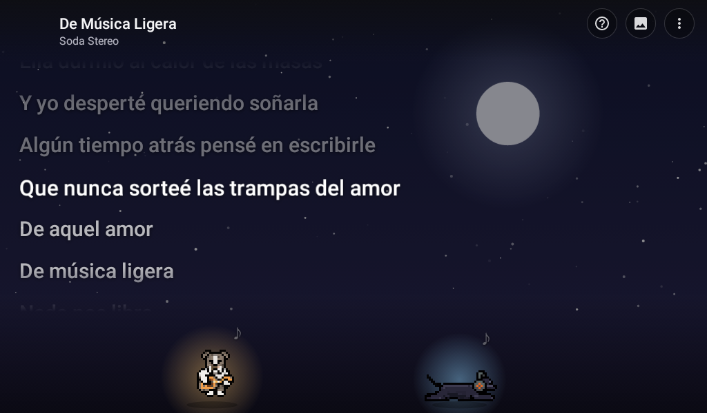<br>La letra de noche: Hunter toca la guitarra y Tango se echa a escuchar.</td>
    <td width="50%">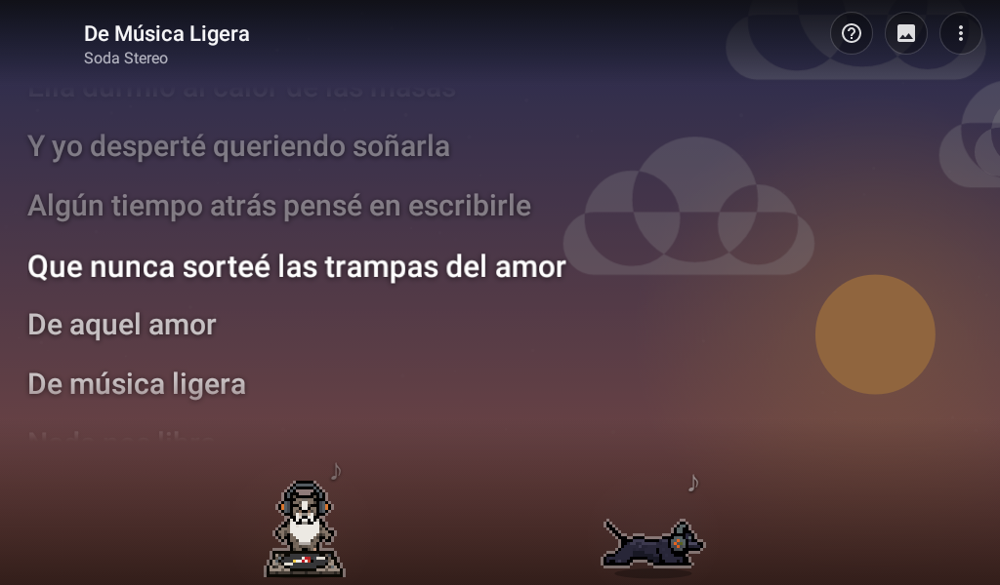<br>Al atardecer, con Hunter de DJ.</td>
  </tr>
  <tr>
    <td width="50%">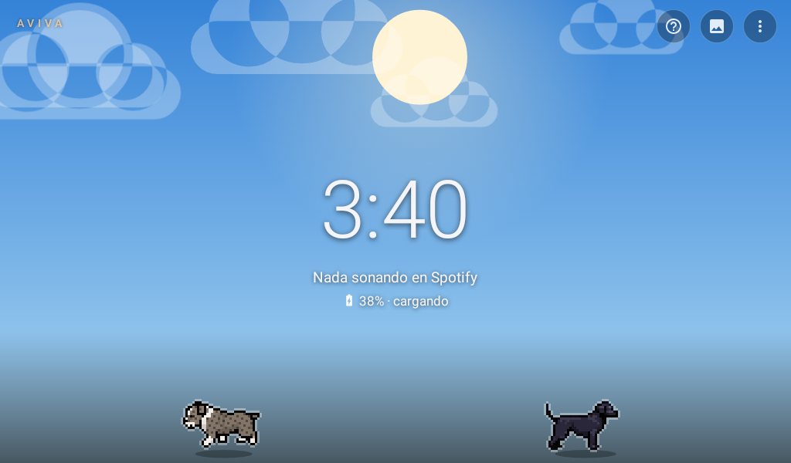<br>Sin música, de día: reloj y batería, y los perros en lo suyo.</td>
    <td width="50%">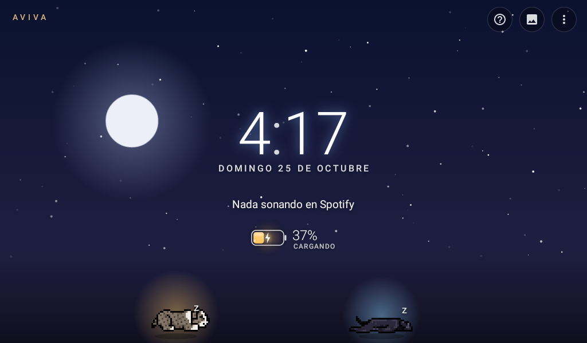<br>De noche: luna en su fase y Hunter y Tango dormidos.</td>
  </tr>
  <tr>
    <td width="50%">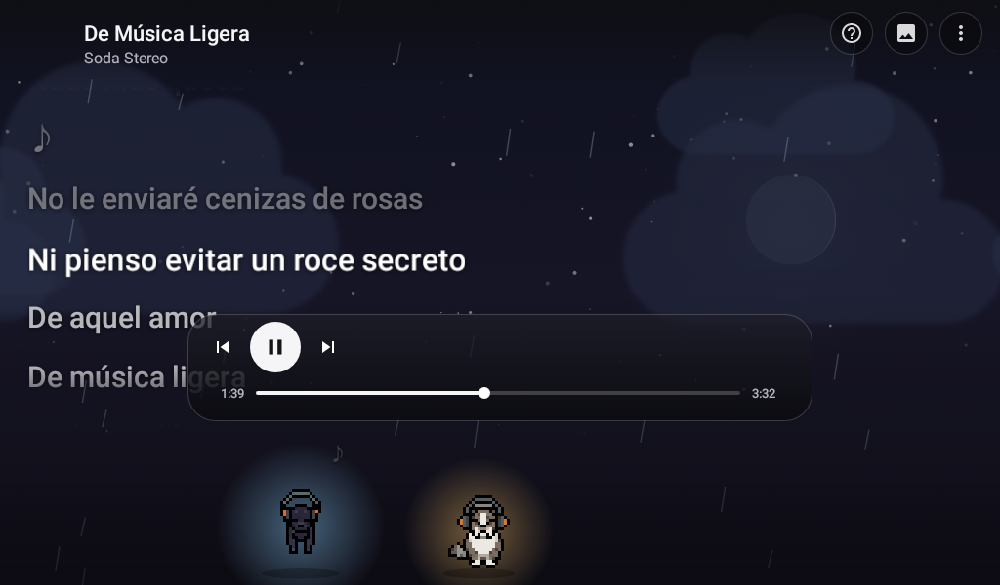<br>Al tocar la pantalla sale la píldora de la música; el renglón que se canta sube arriba de ella.</td>
    <td width="50%">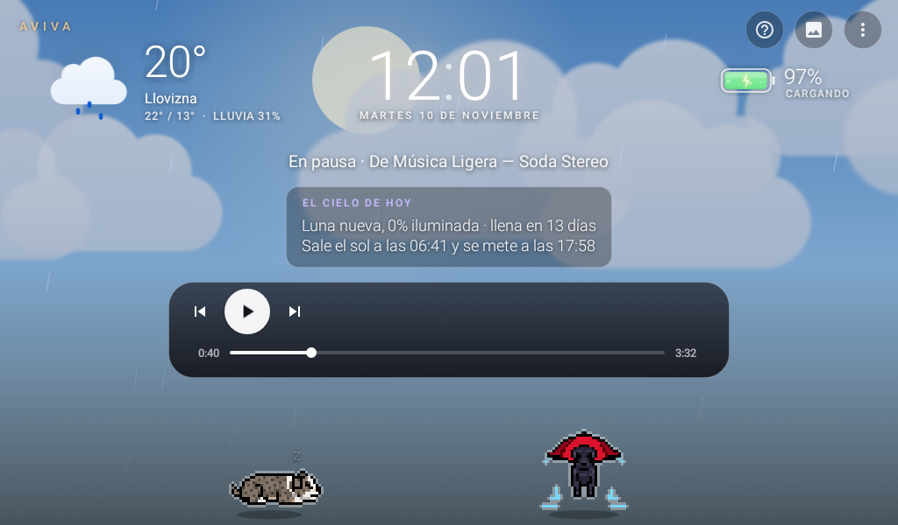<br>En pausa: el reloj con los controles de la música a la mano.</td>
  </tr>
  <tr>
    <td colspan="2">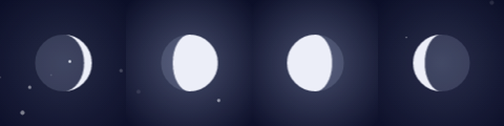<br>La luna sigue su fase real: creciente, gibosa, menguante…</td>
  </tr>
</table>

Con fondos de imágenes (arte lofi, tus fotos) se ve igual, con la imagen detrás; esas no se publican aquí porque
son de sus autores.

## Qué hace

- **Letra al ritmo de la canción.** La línea que se canta se resalta y la pantalla avanza sola.
- **De dónde sale la música:**
  1. **Javbots** (la oficina de agentes en la PC): sabe exactamente qué suena en el Spotify de la PC y ya trae
     la letra oficial. La tablet encuentra la PC sola en la red.
  2. **API de Spotify** (respaldo, opcional): para cuando suena en otro aparato (o la PC no tiene Javbots prendido).
     Letra de [LRCLIB](https://lrclib.net).
- **Botones siempre a la vista** arriba a la derecha, de madera como el cuarto: un letrero con **?** (la ayuda;
  se columpia al tocarlo), la ventanita del fondo y una **comodita de tres cajones** (las opciones: sus tres
  perillas son los tres puntitos; al tocarla se abre el cajón de en medio y adentro está el hueso de Tango).
- **Los menús también son escenitas en pixel** (nada de diálogos grises de Android):
  - **Opciones = el cajón de la comodita abierto**: una ficha de biblioteca por opción sobre fieltro, con un objeto
    que cambia con el valor (el reloj digital, la persiana que baja, la luna, el libro del idioma…) y su control:
    perilla de latón (varios valores: gira un clic), interruptor (sí/no) o pestañita (abre otra cosa). Lo que cambia
    un valor se cambia ahí mismo y el cajón sigue abierto, para ver el efecto detrás. Tango se echa en el hueco a
    morder su hueso. En horizontal, dos columnas.
  - **Cómo se usa = una libretita de espiral**: una sección por hoja con el dibujito del control del que habla,
    pestañas de colores para brincar, y se pasa la hoja deslizando o con la esquina doblada. En horizontal se abre
    en dos hojas.
  - **Reproducir en… = un mueble con los aparatos de la casa** que sube desde abajo: la PC, el celular, la bocina, la
    tele, la tablet, cada uno con su placa. El que suena lleva placa de latón, notitas y a Hunter con audífonos; al
    escoger otro, las notitas viajan en arco y Hunter corre para allá.

    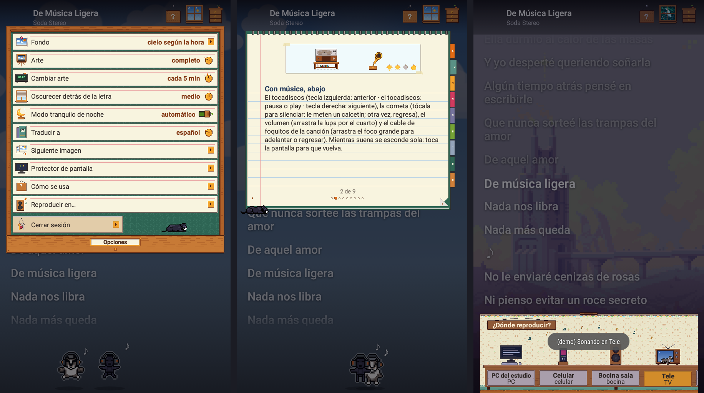
- **Controles de la música** en una píldora flotante arriba de los perros: anterior, play/pausa, siguiente,
  volumen y la barra de la canción.
  - **Anterior, play/pausa y siguiente son un tocadiscos** en otro rincón del mismo cuarto, en una cápsula hermana
    de la del volumen: la tecla de la izquierda es anterior, la de la derecha siguiente (se hunden y se ponen
    naranjas) y todo el tocadiscos es play/pausa (rebota). Sonando, el disco gira, el brazo está sobre él y salen
    notitas; en pausa, el brazo se levanta. Al pasar de canción el disco sale hacia ese lado y entra otro con la
    etiqueta del color de la portada, y cruza corriendo Tango (siguiente) o Hunter (anterior). Si la canción cambia
    sola, solo cambia el disco.

    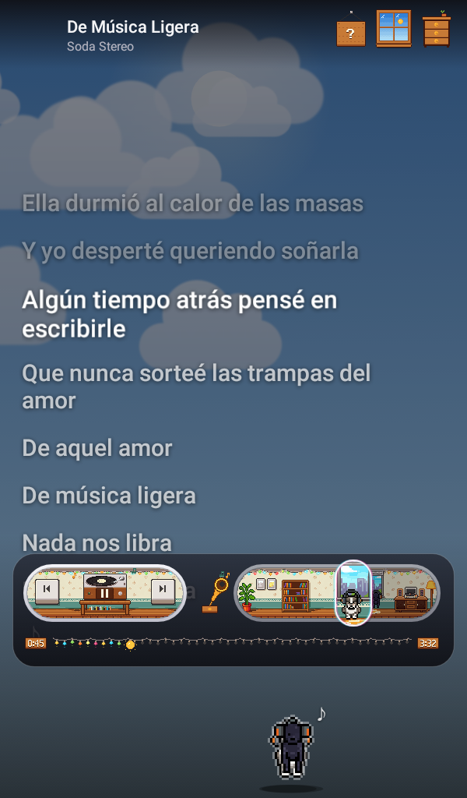
  - **La barra de la canción es un cable de foquitos** como el del cuarto: lo ya escuchado va con los focos
    prendidos. La bolita es un foco grande que late con la música (al pulso, si llega el tempo) y en pausa se
    apaga a medias. Al arrastrarlo (todo el renglón se puede agarrar) crece, el letrero de la izquierda se enciende
    con el tiempo al que vas y Tango corre detrás del foco. Los tiempos van en letreritos de madera.
  - **La bocina de silencio es la corneta de un gramófono:** sonando le salen notitas; tócala y le meten un
    calcetín rojo en la boca (así se callaban los gramófonos); otra vez y regresa el volumen.
  - **El volumen es el cuarto de Hunter y Tango:** una cápsula con su cuartito en pixel art, y lo que se arrastra es
    una lupa de vidrio que agranda lo que pasa por debajo. En silencio duermen, bajito se echan a escuchar, a medio
    volumen mueven la cabeza y fuerte hacen fiesta. De noche el cuarto se oscurece, se ven las estrellas por la
    ventana y se prende la lámpara.

    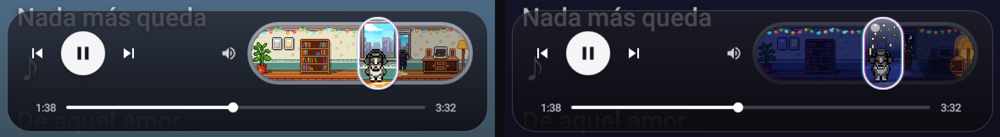
  - Van por Javbots (Spotify de la PC) o por la API de Spotify, al aparato donde esté sonando. Por la API piden
    Spotify Premium; adelantar y el volumen exacto necesitan la sesión de Spotify en la tablet.
  - Responden al instante: la pausa o el salto se ven en seguida, sin esperar a que Spotify conteste.
  - Sonando, se esconden solos a los 6 s y vuelven al tocar la pantalla. En pausa se quedan.
- **Movimiento suave:** los botones se hunden y rebotan, con canción
  nueva el título se desliza y la portada aparece con un rebote, la letra entra subiendo y avanza arrancando y
  frenando suave.
- **Traducción de la letra** (español o inglés): en horizontal, dos columnas (original y traducción); en vertical,
  un toque en la letra la cambia. Si la canción ya está en ese idioma, no se traduce.
- **En pausa** más de 20 s pasa al reloj con el botón de play a la mano.
- **Modo tranquilo de noche:** si de noche suena música para dormir (tempo lento, o lofi, ambient, piano,
  lluvia… en el título, artista o disco), baja el brillo, oscurece la letra y Hunter y Tango se acuestan a escuchar
  con audífonos hasta dormirse. Si hay una carpeta `Dormir` en tus fondos, usa esas imágenes. Se apaga en Opciones.
- **Reloj** con brillo según el cielo (azul de noche, durazno de día), los dos puntos latiendo y la fecha abajo.
- **Clima** junto al reloj ([Open-Meteo](https://open-meteo.com), sin clave), en pixel art: una cápsula como la
  del volumen con el patio de afuera (el cielo según el clima, la ciudad del cuarto y el pasto) y la temperatura en
  un letrero de madera clavado en el pasto; a un lado, el cielo en palabras, la máxima, la mínima y la lluvia. Un
  perro reacciona: con lluvia Tango saca el paraguas (también "por si acaso" si la probabilidad es de 60 % o más),
  con tormenta se asusta, con sol Hunter se pone lentes, de noche despejada saca el telescopio, con calor Tango come
  nieve, con frío o nieve Hunter se pone la bufanda, nublado mira al cielo y con niebla Tango va olfateando. De
  noche, un foquito alumbra el letrero. Se pide cada media hora.
- **Batería** como el plato de croquetas de Hunter y Tango: copetón al 100 %, a la mitad, tres croquetas cuando
  queda poca. Cargando, el costal está junto al plato y Hunter espera; al conectarla salta una chispa y caen
  croquetas; con poca, Tango llega a olfatear el plato vacío. El porcentaje va en números de pixel (blanco, ámbar o
  rojo). Con la letra, si queda poca, sale junto al título.
- **Casi todo quieto:** el perro del clima hace lo suyo una vez (cuando cambia el clima, al aparecer el reloj o al
  tocarlo) y se queda así; la lluvia y la nieve caen solo mientras haya, y con tormenta cae un rayo de vez en cuando.
  Sobre el cielo van con pixeles dobles para leerlos de lejos (en vertical, uno arriba del otro y el reloj sube); en
  horizontal y con imagen de fondo, a tamaño normal.

  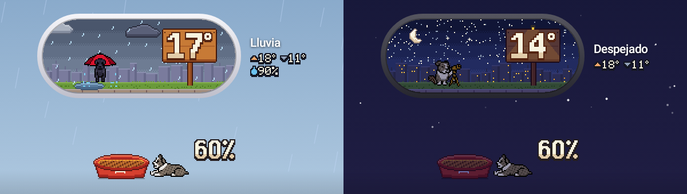
- **Tarjeta de datos** bajo el reloj, cambia cada 25 s: el cielo de hoy (fase de la luna, días para la llena,
  salida y puesta del sol), "un día como hoy" (Wikipedia en español), un dato geek y tus propias frases.
  En vertical, el clima y la pila van juntos abajo de la tarjeta.
- **Sin la PC** (apagada o dormida) dice "Nada sonando" y la busca por detrás, sin anunciarlo.
- **Protector de pantalla:** con la tablet cargando, en vez de apagarse muestra esta misma pantalla
  (Ajustes → Pantalla → Protector de pantalla → Letras). Botón ✕ para salir.
- **Fondos:** la ventanita de arriba enseña en chiquito el fondo que se ve; al tocarla sube una **charola de
  postales**, una por fondo (el cielo y cada carpeta), con la actual marcada con una chinche y Hunter sentado junto a
  ella. Tocar otra la elige (Hunter brinca hasta allá) y la charola se cierra sola; tocar fuera, el botón de atrás o
  12 s sin tocarla también la cierran. El **doble toque** en la pantalla sigue pasando al siguiente fondo.
  - **Cielo según la hora:** amanecer, día con nubes, atardecer, noche con estrellas y la **luna en su fase de
    hoy** (creciente, llena, menguante…, calculada por la fecha).
  - **Y según el clima de verdad:** despejado casi sin nubes; nublado, el cielo lleno y más gris; con lluvia cae
    lluvia y el sol apenas se asoma; tormenta con relámpagos; niebla abajo; nieve (por si acaso).
  - **Una carpeta de imágenes:** cada carpeta de `Pictures/Letras/fondos` es una opción con su nombre (Lofi, Boda,
    Hunter y Tango…). Se ve igual con música y sin música; sin música cambia cada 2 minutos, como marco de fotos,
    con el reloj chico en la esquina. La flechita (›) de abajo pasa a la siguiente. Con la tablet parada usa las
    verticales (si hay), y las que casi tienen la forma de la pantalla la llenan.
- **Hunter y Tango** en la orilla de abajo:

  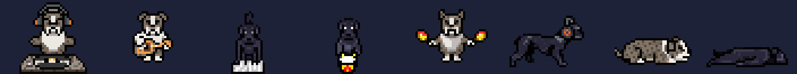

  - Suena música: se ponen **audífonos**, pasean, **mueven la cabeza**, se sientan moviendo la cola y **tocan**:
    Hunter de DJ, guitarra y maracas; Tango teclado, guitarra, maracas y tambor. Si Spotify da el tempo de la
    canción, se mueven **al pulso**.
  - Se busca la letra: **corren**. Aparece la letra: **bailan** un momento.
  - **De día** sin música: olfatean, se rascan, se estiran, mordisquean un hueso, juegan, ladran, se sacuden,
    persiguen su cola, ruedan, miran al cielo… y a veces toman una siesta.
  - **De noche** sin música: se duermen en distintas posiciones (echados, enroscados, de lado, como rana) y a
    veces **sueñan**: mueven las patitas y sale una nube con un hueso, una pelota, una ardilla…
  - De noche llevan su lucecita; de día, un contorno claro para que se vean sobre cualquier fondo.
  - **Con el clima:** si llueve sacan el paraguas o brincan en los charcos; con tormenta se tapan los ojos; con
    frío, bufanda; en día caluroso, Hunter se pone lentes de sol y Tango se va a la playa (toalla y sombrilla, coco o paleta). De noche despejada, a veces sacan
    el telescopio.
  - **Presentan la tarjeta de datos:** cuando cambia, uno la señala; con "un día como hoy" lee el periódico.
  - Con **luna llena** le aúllan antes de dormirse.
  - Tienen un secreto. Tócalos.

## Poner tus imágenes

Conecta la tablet a la PC por USB, ábrela en el Explorador de archivos y entra a `Pictures/Letras/fondos/`.
**Cada carpeta que hagas ahí es un fondo** y sale en la app con su nombre:

```
Pictures/Letras/fondos/
├── Lofi/              ← arte de artistas lofi
│   ├── dia/           ← (opcional) solo de día
│   └── noche/         ← (opcional) solo de noche
├── Boda/              ← tus fotos
└── Hunter y Tango/
```

- Las imágenes sueltas en la carpeta salen a cualquier hora; las de `dia/` y `noche/`, solo a esa hora.
- Sirven **JPG, PNG, WebP y GIF animado** (hasta 25 MB cada uno). Fotos de la cámara tal cual.
- **Crédito:** si el archivo se llama `Artista - Título.gif`, sale "Arte: Artista · Título". Si no (IMG_1234.jpg),
  no sale nada.
- Una carpeta vacía no aparece. No hace falta reiniciar la app.

Por cable con adb: `adb push "Artista - Título.gif" "/sdcard/Pictures/Letras/fondos/Lofi/"`

### Tus frases

`Pictures/Letras/datos.txt`, una por renglón. Con fecha (`día/mes`) solo sale ese día; sin fecha, cualquiera:

```
25/10 Hoy cumple Tango
Te quiero
# los renglones con # no salen
```

## Opciones (mantener presionado en la pantalla, o la comodita)

Cada ficha del cajón dice su valor; las de perilla o interruptor cambian al tocarlas (y el cajón sigue abierto), las
de pestañita cierran el cajón y abren lo suyo. Se cierra tocando fuera o con atrás.

| Opción                         | Valores                                                   |
| ------------------------------ | --------------------------------------------------------- |
| Fondo                          | abre la charola de postales (cielo o una de tus carpetas) |
| Arte                           | completo (con relleno borroso) · llenar la pantalla       |
| Cambiar imagen (con música)    | con cada canción · cada 5, 15 o 60 min                    |
| Oscurecer detrás de la letra   | poco · medio · mucho                                      |
| Modo tranquilo de noche        | automático · apagado                                      |
| Traducir a                     | español · inglés · no (horizontal: dos columnas; vertical: un toque en la letra la cambia) |
| Siguiente imagen               | (también la flechita junto al crédito)                    |
| Protector de pantalla          | abre los ajustes de Android para elegirlo                 |
| Cómo se usa                    | la libretita de ayuda (una hoja por sección; en la del protector, el botón para abrir sus ajustes) |
| Reproducir en…                 | (si hay sesión) el mueble de los aparatos: toca uno y la música se pasa ahí |
| Cerrar sesión de Spotify       | (si hay sesión; sin sesión y con client ID: Conectar con Spotify) |

## Configurar y compilar

`android/local.properties` (no se sube a git):

```properties
sdk.dir=C\:/Users/<tú>/AppData/Local/Android/Sdk
javbots.token=<token de ~/.pixel-agents/music.json>
# opcionales
javbots.host=
javbots.port=3101
spotify.clientId=
# clima: un punto aproximado (sin él no sale el clima)
clima.lat=
clima.lon=
```

En la PC, Javbots necesita `"screenPort": 3101` en `~/.pixel-agents/music.json` (ver el README de música de Javbots).

```bash
cd android
./gradlew :app:assembleDebug
adb install -r app/build/outputs/apk/debug/app-debug.apk
```

Sin AndroidX ni librerías de red a propósito: la tablet es API 22 y tiene 1 GB. El APK pesa ~1.5 MB.
Android 5.1 no trae la raíz de Let's Encrypt (la usan Open-Meteo y Wikipedia): la app suma ISRG Root X1 y X2
(`app/src/main/resources/certs`) a las del sistema.

## Cómo está hecho el código

Android 5.1 sin AndroidX (no hay ViewModel), así que la arquitectura es **MVI** a mano:

```
acciones ──► reduce(estado, acción) ──► estado nuevo + efectos
(consulta, tiempo,      ScreenState.kt         │          │
 batería, botones)      (Kotlin puro)          ▼          ▼
                                        Pantalla.render   Pantalla.perform
                                        (dibuja lo que    (buscar letra, portada,
                                         cambió)           imagen, botones de la música)
```

| Archivo | Qué hace |
| --- | --- |
| `ScreenState.kt` | Estado, acciones, efectos y `reduce`. Sin Android: se prueba en la PC. |
| `Pantalla.kt` | Vistas: manda acciones, dibuja el estado y hace los efectos. La usan la app y el protector. |
| `MainActivity.kt` / `Protector.kt` | La app (inicio de sesión, menús) y el protector de pantalla. |
| `JavbotsSource.kt`, `SpotifyPlayer.kt`, `Lyrics.kt` | De dónde sale la música y la letra. |
| `Datos.kt`, `Clima.kt` | Las tarjetas de datos (Kotlin puro, con pruebas) y de dónde salen (clima, Wikipedia, tus frases). |
| `SkyView`, `DogsView`, `ArtView`, `ClockView`, `BatteryView`, `WeatherView` | Vistas que se dibujan solas (cielo y luna, Hunter y Tango, imágenes, reloj, batería, clima). |
| `VolumeCapsule` | El volumen: el cuarto de Hunter y Tango con la lupa de vidrio. |
| `Menus.kt` | Lo que deciden los menús en pixel (qué opciones salen, control y posición de cada una, hojas de la ayuda, aparato por tipo). Kotlin puro, con pruebas. |
| `OptionsPanel`, `HelpNotebook`, `DevicesTray` | El cajón de opciones, la libretita de ayuda y el mueble de "Reproducir en…" (Canvas, arte de `arte/controles/armar_menus.py`). |

Pruebas (en la PC, sin tablet):

```bash
cd android
./gradlew :app:testDebugUnitTest
```

## Créditos

- Hunter y Tango: los personajes de [Javbots](https://github.com/DeveloperJGV/Javbots), con poses nuevas hechas en
  [PixelLab](https://pixellab.ai). Los cuadros originales están en `arte/pixellab/` y `arte/armar_perros.py` arma
  las hojas de la app (Hunter se recolorea a gris atigrado).
- Letras: Spotify (vía Javbots) y [LRCLIB](https://lrclib.net).
- Forma de las nubes del cielo: [Meteocons](https://github.com/basmilius/meteocons) de Bas Milius (MIT,
  `arte/meteocons/LICENSE`), con `arte/meteocons/split.py` y `render.mjs`.
- El clima y la pila en pixel: dibujados por código en `arte/controles/maquetas_clima_bateria.py` y exportados a la
  app con `arte/controles/armar_clima_bateria.py` (`clima_*.png`, `plato_*.png`).
- Clima: [Open-Meteo](https://open-meteo.com) (CC BY 4.0). Efemérides: [Wikipedia en español](https://es.wikipedia.org) (CC BY-SA).
- Fondos de artistas: de sus autores, con el crédito que se muestra en pantalla. No se incluyen en este repo.
- El cuarto del volumen: hecho en [PixelLab](https://pixellab.ai) (de día, y la noche editando ese mismo),
  originales en `arte/pixellab/cuarto/`.
- El tocadiscos, las postales, la ventanita, el cable de foquitos, la corneta, el letrero y la comodita: dibujados con Python (Pillow) en `arte/controles/armar_controles.py`
  sobre la pared y los colores del cuarto (sin PixelLab); las maquetas de las opciones en `arte/controles/maquetas.py` y `maquetas_barra_botones.py`.
- Los menús (cajón, libretita, mueble de aparatos): dibujados con Python en `arte/controles/maquetas_menus.py` (maquetas)
  y exportados con `arte/controles/armar_menus.py` (`menu_*.png`, `libreta_*.png`, `aparato_*.png`), sin PixelLab.
- Íconos del botón ✕ del protector: [Material Icons](https://fonts.google.com/icons) (Apache 2.0).
