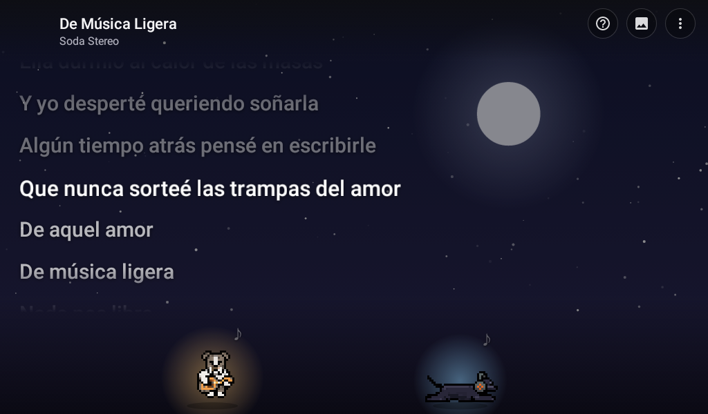
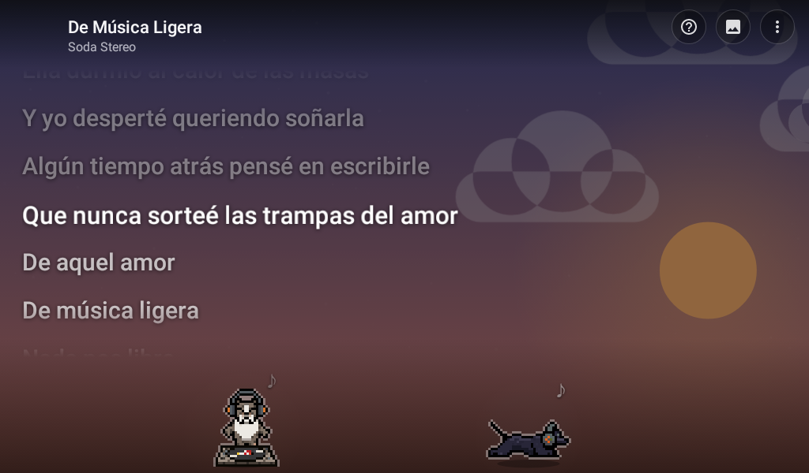
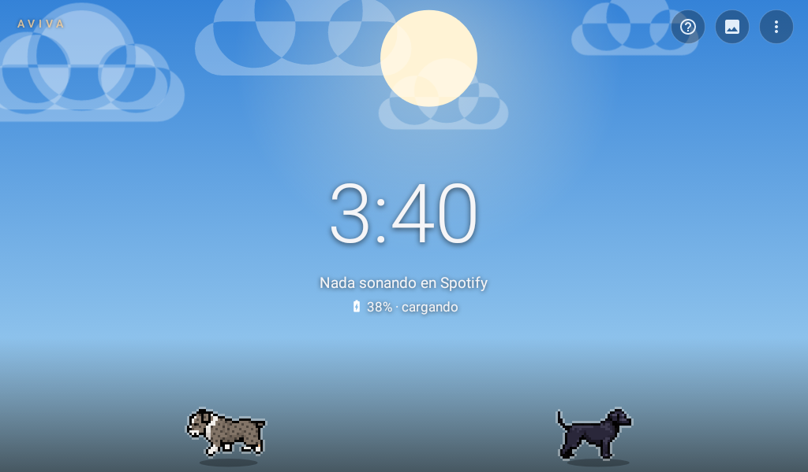
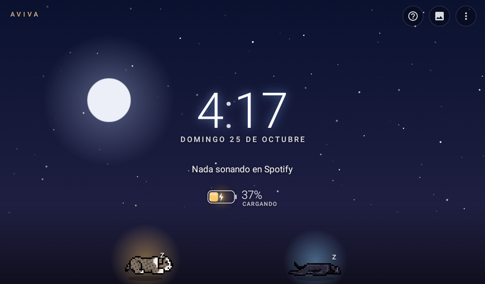
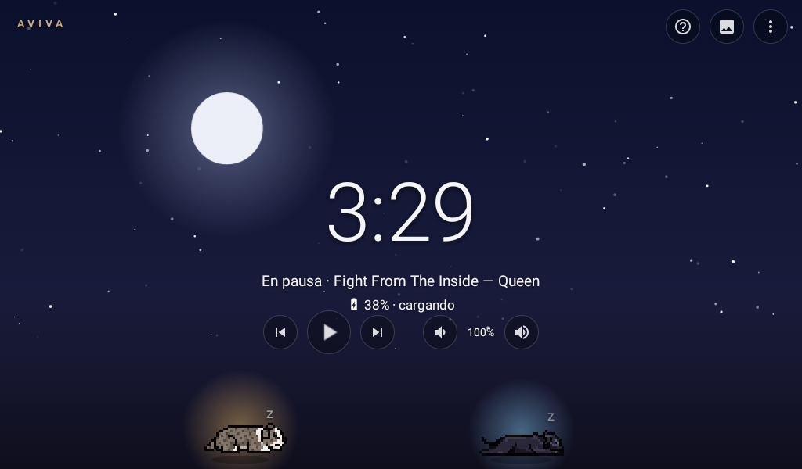
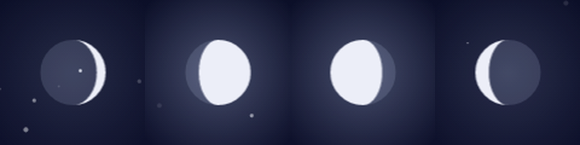
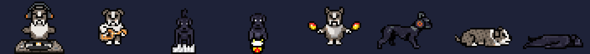

# Letras

-3DDC84?logo=android&logoColor=white)


Un proyecto de **AVIVA**. ("Letras" es nombre provisional.) App para una tablet vieja (Lenovo Tab 3 7, Android 5.1, 1 GB) que la convierte en una pantalla de la casa:
muestra la **letra sincronizada** de lo que suena en Spotify, sobre un fondo vivo, con Hunter y Tango
paseando abajo. Cuando no suena nada: reloj, sobre el cielo o sobre tus imágenes.

<table>
  <tr>
    <td width="50%"><br>La letra de noche: Hunter toca la guitarra y Tango se echa a escuchar.</td>
    <td width="50%"><br>Al atardecer, con Hunter de DJ.</td>
  </tr>
  <tr>
    <td width="50%"><br>Sin música, de día: reloj y batería, y los perros en lo suyo.</td>
    <td width="50%"><br>De noche: luna en su fase y Hunter y Tango dormidos.</td>
  </tr>
  <tr>
    <td width="50%"><br>En pausa: el reloj con los botones de la música a la mano.</td>
    <td width="50%"><br>La luna sigue su fase real: creciente, gibosa, menguante…</td>
  </tr>
</table>

Con fondos de imágenes (arte lofi, tus fotos) se ve igual, con la imagen detrás; esas no se publican aquí porque
son de sus autores.

## Qué hace

- **Letra al ritmo de la canción.** La línea que se canta se resalta y la pantalla avanza sola.
- **De dónde sale la música:**
  1. **Javbots** (la oficina de agentes en la PC): sabe exactamente qué suena en el Spotify de la PC y ya trae
     la letra oficial. La tablet encuentra la PC sola en la red.
  2. **API de Spotify** (respaldo, opcional): para cuando suena en otro aparato. Letra de [LRCLIB](https://lrclib.net).
- **Botones siempre a la vista** arriba a la derecha: ayuda (?), cambiar fondo y opciones.
- **Controles de la música** (con Javbots): anterior, pausa, siguiente y volumen del Spotify de la PC, abajo,
  arriba de los perros.
- **En pausa** más de 20 s pasa al reloj con el botón de play a la mano.
- **Reloj** con brillo según el cielo (azul de noche, durazno de día), los dos puntos latiendo y la fecha abajo.
- **Batería** junto al reloj: una pila que se llena con su color (verde, ámbar, rojo), con burbujas y un rayo que
  late mientras carga. Con la letra, si queda poca, sale junto al título.
- **Clima** del otro lado del reloj ([Open-Meteo](https://open-meteo.com), sin clave): temperatura, cielo,
  máxima/mínima y probabilidad de lluvia, con un dibujito que se mueve. Se pide cada media hora.
- **Tarjeta de datos** bajo el reloj, cambia cada 25 s: el cielo de hoy (fase de la luna, días para la llena,
  salida y puesta del sol), "un día como hoy" (Wikipedia en español), un dato geek y tus propias frases.
  En vertical, el clima y la pila van juntos abajo de la tarjeta.
- **Sin la PC** (apagada o dormida) dice "Nada sonando" y la busca por detrás, sin anunciarlo.
- **Protector de pantalla:** con la tablet cargando, en vez de apagarse muestra esta misma pantalla
  (Ajustes → Pantalla → Protector de pantalla → Letras). Botón ✕ para salir.
- **Fondos** (botón del cuadrito o doble toque para cambiar):
  - **Cielo según la hora:** amanecer, día con nubes, atardecer, noche con estrellas y la **luna en su fase de
    hoy** (creciente, llena, menguante…, calculada por la fecha).
  - **Una carpeta de imágenes:** cada carpeta de `Pictures/Letras/fondos` es una opción con su nombre (Lofi, Boda,
    Hunter y Tango…). Se ve igual con música y sin música; sin música cambia cada 2 minutos, como marco de fotos,
    con el reloj chico en la esquina. La flechita (›) de abajo pasa a la siguiente. Con la tablet parada usa las
    verticales (si hay), y las que casi tienen la forma de la pantalla la llenan.
- **Hunter y Tango** en la orilla de abajo:

  

  - Suena música: se ponen **audífonos**, pasean, **mueven la cabeza**, se sientan moviendo la cola y **tocan**:
    Hunter de DJ, guitarra y maracas; Tango teclado, guitarra, maracas y tambor. Si Spotify da el tempo de la
    canción, se mueven **al pulso**.
  - Se busca la letra: **corren**. Aparece la letra: **bailan** un momento.
  - **De día** sin música: olfatean, se rascan, se estiran, mordisquean un hueso, juegan, ladran, se sacuden,
    persiguen su cola, ruedan, miran al cielo… y a veces toman una siesta.
  - **De noche** sin música: se duermen en distintas posiciones (echados, enroscados, de lado, como rana) y a
    veces **sueñan**: mueven las patitas y sale una nube con un hueso, una pelota, una ardilla…
  - De noche llevan su lucecita; de día, un contorno claro para que se vean sobre cualquier fondo.
  - Con **luna llena** le aúllan antes de dormirse.
  - Tienen un secreto. Tócalos.

## Poner tus imágenes

Conecta la tablet a la PC por USB, ábrela en el Explorador de archivos y entra a `Pictures/Letras/fondos/`.
**Cada carpeta que hagas ahí es un fondo** y sale en la app con su nombre:

```
Pictures/Letras/fondos/
├── Lofi/              ← arte de artistas lofi
│   ├── dia/           ← (opcional) solo de día
│   └── noche/         ← (opcional) solo de noche
├── Boda/              ← tus fotos
└── Hunter y Tango/
```

- Las imágenes sueltas en la carpeta salen a cualquier hora; las de `dia/` y `noche/`, solo a esa hora.
- Sirven **JPG, PNG, WebP y GIF animado** (hasta 25 MB cada uno). Fotos de la cámara tal cual.
- **Crédito:** si el archivo se llama `Artista - Título.gif`, sale "Arte: Artista · Título". Si no (IMG_1234.jpg),
  no sale nada.
- Una carpeta vacía no aparece. No hace falta reiniciar la app.

Por cable con adb: `adb push "Artista - Título.gif" "/sdcard/Pictures/Letras/fondos/Lofi/"`

### Tus frases

`Pictures/Letras/datos.txt`, una por renglón. Con fecha (`día/mes`) solo sale ese día; sin fecha, cualquiera:

```
25/10 Hoy cumple Tango
Te quiero
# los renglones con # no salen
```

## Opciones (mantener presionado en la pantalla)

| Opción                         | Valores                                                   |
| ------------------------------ | --------------------------------------------------------- |
| Fondo                          | cielo o una de tus carpetas (lista para escoger)          |
| Arte                           | completo (con relleno borroso) · llenar la pantalla       |
| Cambiar imagen (con música)    | con cada canción · cada 5, 15 o 60 min                    |
| Oscurecer detrás de la letra   | poco · medio · mucho                                      |
| Siguiente imagen               | (también la flechita junto al crédito)                    |
| Protector de pantalla          | abre los ajustes de Android para elegirlo                 |
| Cómo se usa                    | la ayuda                                                  |
| Cerrar sesión de Spotify       | (si hay sesión)                                           |

## Configurar y compilar

`android/local.properties` (no se sube a git):

```properties
sdk.dir=C\:/Users/<tú>/AppData/Local/Android/Sdk
javbots.token=<token de ~/.pixel-agents/music.json>
# opcionales
javbots.host=
javbots.port=3101
spotify.clientId=
# clima: un punto aproximado (sin él no sale el clima)
clima.lat=
clima.lon=
```

En la PC, Javbots necesita `"screenPort": 3101` en `~/.pixel-agents/music.json` (ver el README de música de Javbots).

```bash
cd android
./gradlew :app:assembleDebug
adb install -r app/build/outputs/apk/debug/app-debug.apk
```

Sin AndroidX ni librerías de red a propósito: la tablet es API 22 y tiene 1 GB. El APK pesa ~1.5 MB.
Android 5.1 no trae la raíz de Let's Encrypt (la usan Open-Meteo y Wikipedia): la app suma ISRG Root X1 y X2
(`app/src/main/resources/certs`) a las del sistema.

## Cómo está hecho el código

Android 5.1 sin AndroidX (no hay ViewModel), así que la arquitectura es **MVI** a mano:

```
acciones ──► reduce(estado, acción) ──► estado nuevo + efectos
(consulta, tiempo,      ScreenState.kt         │          │
 batería, botones)      (Kotlin puro)          ▼          ▼
                                        Pantalla.render   Pantalla.perform
                                        (dibuja lo que    (buscar letra, portada,
                                         cambió)           imagen, botón a la PC)
```

| Archivo | Qué hace |
| --- | --- |
| `ScreenState.kt` | Estado, acciones, efectos y `reduce`. Sin Android: se prueba en la PC. |
| `Pantalla.kt` | Vistas: manda acciones, dibuja el estado y hace los efectos. La usan la app y el protector. |
| `MainActivity.kt` / `Protector.kt` | La app (inicio de sesión, menús) y el protector de pantalla. |
| `JavbotsSource.kt`, `SpotifyPlayer.kt`, `Lyrics.kt` | De dónde sale la música y la letra. |
| `Datos.kt`, `Clima.kt` | Las tarjetas de datos (Kotlin puro, con pruebas) y de dónde salen (clima, Wikipedia, tus frases). |
| `SkyView`, `DogsView`, `ArtView`, `ClockView`, `BatteryView`, `WeatherView` | Vistas que se dibujan solas (cielo y luna, Hunter y Tango, imágenes, reloj, batería, clima). |

Pruebas (en la PC, sin tablet):

```bash
cd android
./gradlew :app:testDebugUnitTest
```

## Créditos

- Hunter y Tango: los personajes de [Javbots](https://github.com/DeveloperJGV/Javbots), con poses nuevas hechas en
  [PixelLab](https://pixellab.ai). Los cuadros originales están en `arte/pixellab/` y `arte/armar_perros.py` arma
  las hojas de la app (Hunter se recolorea a gris atigrado).
- Letras: Spotify (vía Javbots) y [LRCLIB](https://lrclib.net).
- Clima: [Open-Meteo](https://open-meteo.com) (CC BY 4.0). Efemérides: [Wikipedia en español](https://es.wikipedia.org) (CC BY-SA).
- Fondos de artistas: de sus autores, con el crédito que se muestra en pantalla. No se incluyen en este repo.
- Íconos de los botones: [Material Icons](https://fonts.google.com/icons) (Apache 2.0).
